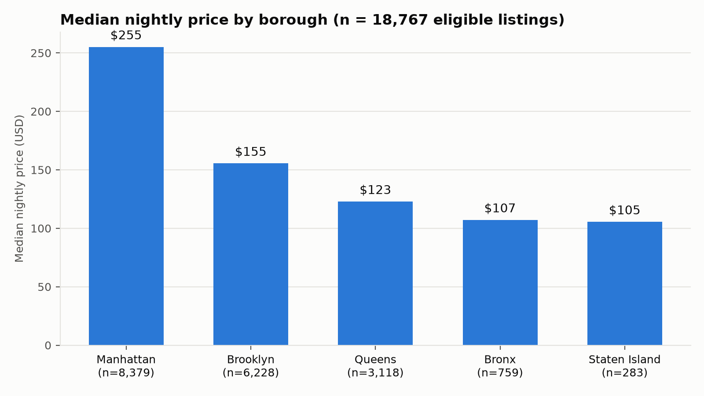
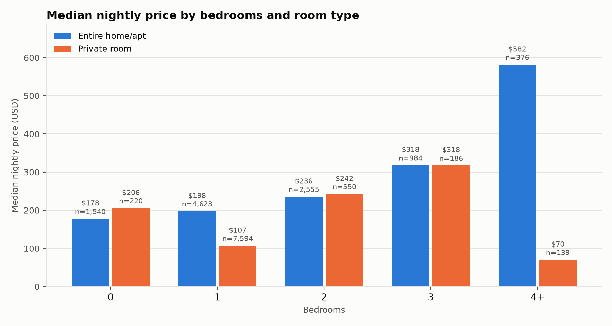
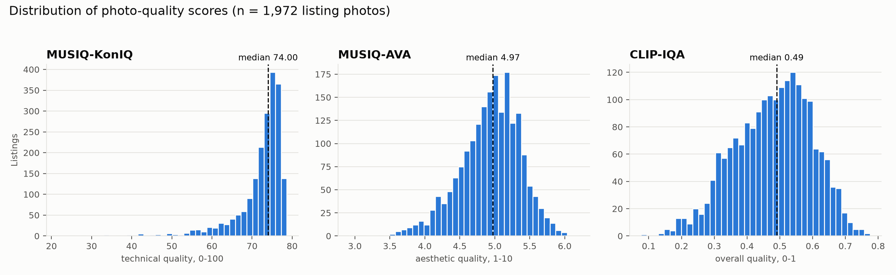
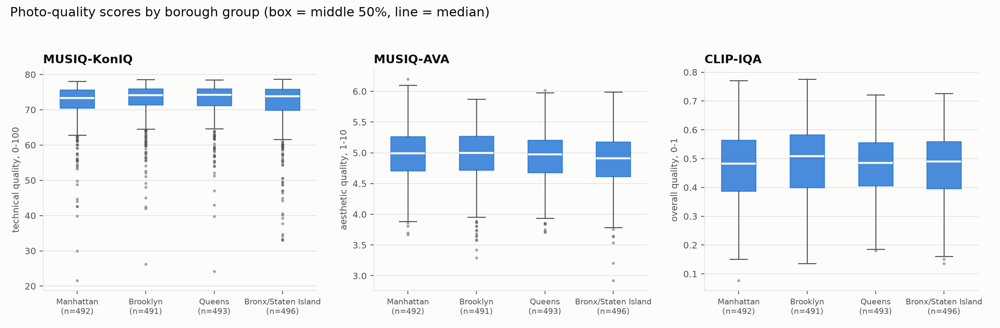

# Data: Airbnb Listing Photos and Nightly Prices in NYC

This folder holds all the data for the project, from the raw Inside Airbnb file to the final dataset used in the models. Everything fits on GitHub and is included, except the listing photos, which are copyrighted (see [License](#license)). The scripts in `SCRIPTS/` turn the raw data into the final data; see the main [README](../README.md) for how to run them.

```
DATA/
├── README.md                     This file (metadata)
├── raw/
│   └── listings.csv              Initial data: Inside Airbnb NYC listings, September 2026 scrape
├── photos/                       Main listing photos, <id>.jpg (NOT in the repo; downloaded by script 01)
├── intermediate/
│   ├── sample_listings.csv       Sample of listings with a usable photo (script 01)
│   └── photo_scores.csv          Photo-quality scores for each sampled listing (script 02)
└── final/
    └── analysis_data.csv         Final dataset analyzed: sample + scores + model variables (script 03)
```

## Data summary

The data come from Inside Airbnb's New York City listings file [4], downloaded in CSV format from its "Get the Data" page. The file is publicly available at no charge. It has 29,918 NYC listings with 90 columns describing each listing's host, location, property, price and reviews. From it, we drew a borough-balanced sample of 2,000 listings, downloaded each one's main photo, and scored the photo with three image-quality models: two MUSIQ models [1] and CLIP-IQA [2].

| File | Rows | Columns | One row is… |
|---|---|---|---|
| `raw/listings.csv` | 29,918 | 90 | one NYC Airbnb listing in the September 2026 scrape |
| `intermediate/sample_listings.csv` | 1,972 | 84 | one sampled listing (raw columns minus personal host fields, plus `borough_group`) |
| `intermediate/photo_scores.csv` | 1,972 | 4 | the three quality scores for one listing's main photo |
| `final/analysis_data.csv` | 1,972 | 98 | one sampled listing with its scores and model variables |

**How the final data was built**
1. **Filtering (script 01).** From the 29,918 raw listings, keep:
   - only "Entire home/apt" and "Private room" listings (29,263 left);
   - only listings with a price, bedrooms, bathrooms and minimum nights (18,767 left);
   - one randomly chosen listing per host (9,518 left).
2. **Stratified sample (script 01).** Draw 500 listings from each of four borough groups: Manhattan, Brooklyn, Queens, and Bronx + Staten Island combined. Both the Bronx and Staten Island are small, and Staten Island has only about 190 eligible listings. That gives 2,000 listings.
3. **Photos (script 01).**
   - Download each listing's main photo at 720 px wide. 28 photos (1.4%) no longer exist on Airbnb, so those listings were dropped, leaving 1,972.
   - The dropped listings were compared with the kept ones on price, borough and room type (`OUTPUT/tables/dropped_photo_check.csv`). The differences were small, given only 28 drops.
4. **Photo scores (script 02).** Score each photo with three pretrained models from the `pyiqa` library. Every photo was scored successfully.
5. **Model variables and split (script 03).**
   - Convert price to a number and take its log.
   - Turn `bathrooms_text` into a number, and encode room type, borough and 30+ night minimum stays as dummy variables.
   - Randomly split the listings 80/20 into training (1,578) and test (394) sets.
   - Standardize each photo score using the training set's mean and SD.

The final dataset has the same number of listings in each borough group: 491–496, after the photo drops. It is 53% entire homes and 47% private rooms. Nightly prices range from $29 to $11,029 (median $160).

### Changes since MI2
The goal and research question are unchanged. Some data details changed as the project progressed:
- **No outlier trimming.**
  - MI2 described a cleaned set of 18,631 listings with extreme prices trimmed.
  - The final pipeline instead keeps every listing with a price and the required fields (18,767). It then takes one listing per host and samples within borough groups.
  - Extreme prices were kept; the log transform reduces their influence.
- **Sampling.** MI2 planned a simple random sample of about 2,000 listings. The final sample is stratified (500 per borough group) and limited to one listing per host. This gives each borough group enough listings for the photo × borough interactions and keeps any one host from appearing more than once.
- **Extra variables.** `shared_bath` (the bathroom is shared) and `min30` (the minimum stay is 30+ nights) were added as controls.
- **Renamed score columns.** MI2's `musiq_technical`, `musiq_aesthetic` and `clip_iqa` are named `musiq_koniq`, `musiq_ava` and `clipiqa` in the data files, after the pretrained models that produce them.
- **Raw data in the repository.** MI2 said the repository would hold only our cleaned subset and photo scores. The raw file is now included in `raw/` so the full pipeline can be reproduced from the initial data (see [License](#license)).

## Provenance

- **Source.**
  - [Inside Airbnb](https://insideairbnb.com/get-the-data/) [4] is an independent, mission-driven project founded in 2015 by Murray Cox. It is now run by the Housing Justice Data Lab, a New York not-for-profit not affiliated with Airbnb [5].
  - It scrapes listing data from Airbnb's public website.
  - Our snapshot is the New York City `listings.csv.gz` (detailed listings), collected September 14–15, 2026 (`last_scraped`).
  - `raw/listings.csv` is that file, decompressed and otherwise unchanged.
- **How price is defined.** `price` is the nightly rate from a quoted 30-night stay [6]. Listings with no open dates in that window have no price; that is why 10,512 raw listings (35.1%) are missing one.
- **Known limitations of the source.**
  - Airbnb blurs listing locations by up to 150 meters [6].
  - Researchers have documented some incorrect values in Inside Airbnb data [7].
- **Listing photos.**
  - Downloaded from Airbnb's image server (`a0.muscache.com`) on November 16, 2026, using each listing's `picture_url`.
  - The 720 px version is requested by inserting `/im/` before `/pictures/` and adding `?im_w=720`. If that fails, the original URL is used.
- **Photo-quality scores.** Computed on November 17, 2026 with `pyiqa` 0.1.16 and its pretrained weights. Scoring ran on an Intel Arc 140V integrated GPU; CPU scores agree to within about 1e-4.
  | Score | pyiqa metric | Model | Measures |
  |---|---|---|---|
  | MUSIQ-KonIQ | `musiq` | MUSIQ [1], trained on KonIQ-10k | Technical quality (sharpness, noise, exposure) |
  | MUSIQ-AVA | `musiq-ava` | MUSIQ [1], trained on AVA | How aesthetically pleasing the photo is |
  | CLIP-IQA | `clipiqa` | CLIP-IQA [2] | Overall perceived quality, from CLIP with quality prompts |
- **Code.** Every step from raw to final data is in `SCRIPTS/01`–`03`, using random seed 42.

## License

- **Inside Airbnb data** is licensed under [CC BY 4.0](https://creativecommons.org/licenses/by/4.0/) [8]. Any use is allowed with credit, and academic work must cite the dataset formally. Citation:
  > Inside Airbnb, "New York City Airbnb listings data, September 2026," Housing Justice Data Lab, 2026. [Data set]. Available: https://insideairbnb.com/get-the-data/
- **Including the raw file.** Inside Airbnb's data policies [8] ask users not to republish its raw data. We include `raw/listings.csv`, unchanged, only so this class project can be reproduced from the initial data, as the course requires. Anyone reusing this data should download it from Inside Airbnb directly rather than from this repository.
- **Listing photos** are copyrighted by their hosts and photographers and are not covered by the CC BY 4.0 license. They are used only to compute quality scores and are **not** redistributed: `DATA/photos/` is git-ignored.
- **Derived data and code** created by this project (the sample, scores, model variables and scripts) are released under this repository's [MIT License](../LICENSE). This is subject to the CC BY 4.0 attribution above for the underlying listing data.

## Ethical statements

- **Real hosts and homes.** The data is public, but it describes real people and places.
  - Host names, "about" text, profile and photo URLs, and profile IDs were removed before any file was saved.
  - `host_id` is kept only to ensure one listing per host. It is the same public identifier Inside Airbnb publishes.
  - We do not try to identify hosts, or exact addresses from the blurred locations.
  - Free-text fields (listing name, description, `host_location`, `host_neighbourhood`) are kept as published, and descriptions can occasionally mention a host's first name.
- **Copyright of photos.**
  - Photos are used only to compute quality scores and are never committed or shared.
  - Any example photos shown in presentations will be few and small, with any people blurred.
  - Photos were requested at a reduced size (720 px), with 8 parallel connections, a timeout and at most 2 retries, to limit load on Airbnb's servers.
- **Who the sample represents.**
  - **Bookable listings only.** Listings with no open dates have no price, so the data leans toward listings that can currently be booked.
  - **Outer boroughs over-represented.** The sample is borough-balanced: Manhattan and Brooklyn are about 80% of all NYC listings, but 50% of the sample.
  - **One listing per host.** Hosts with many listings are reduced to one listing each.
  - So findings may not apply to all NYC listings.
- **Limits of the photo scores.**
  - The models were trained on general photo collections, not real-estate photos. They may favour particular styles, such as professional or brightly lit photos, and their scores are model estimates, not human ratings.
  - They also cannot tell whether a photo is authentic. Heavily edited photos, virtual staging or computer-generated renderings could score as high quality without reflecting the real space.
  - MI2 planned a manual review of 100 random photos to flag these, rerunning the models without flagged photos if more than a few percent were affected.
- **Use of results.**
  - The analysis is observational, so we do not claim that better photos *cause* higher prices.
  - Results should not be used to judge individual hosts.
  - We avoid framing results in ways that would encourage hosts to use misleading photos.

## Data dictionary

### Model variables in `final/analysis_data.csv`
These 25 columns come first in the file. The other 73 are the unchanged Inside Airbnb columns, minus the removed personal fields. They are described in Inside Airbnb's data dictionary, linked from its [Get the Data](https://insideairbnb.com/get-the-data/) page.

| Column | Type | Description | Values / units | Uncertainty / caveats |
|---|---|---|---|---|
| `id` | integer | Airbnb's unique listing ID | unique | 19-digit IDs exceed some spreadsheet precision; read as text outside Python |
| `host_id` | integer | Airbnb's host ID; one listing per host | unique | Kept only for de-duplication |
| `split` | text | Train/test assignment (random 80/20, seed 42) | `train` (1,578), `test` (394) | |
| `price` | number | Nightly price, from a quoted 30-night stay [6] | USD, 28.76–11,028.87 | Advertised rate, not what guests paid; extreme values kept |
| `log_price` | number | Natural log of `price`; **dependent variable**. Log price is standard in Airbnb price models [3] | 3.36–9.31 | |
| `room_type` | text | Listing type | `Entire home/apt` (1,037), `Private room` (935) | |
| `private_room` | 0/1 | 1 = Private room (baseline: Entire home/apt) | 47% are 1 | |
| `bedrooms` | number | Number of bedrooms | 0–8 | 0 usually means a studio. For private rooms it may count the whole home, hence the room type × bedrooms interaction |
| `bathrooms_text` | text | Bathrooms as written by Inside Airbnb | e.g. `1.5 shared baths` | Wording varies |
| `bathrooms` | number | Number of bathrooms parsed from `bathrooms_text`; any half-bath label = 0.5 | 0–6 | A few listings report 0 bathrooms |
| `shared_bath` | 0/1 | 1 = `bathrooms_text` contains "shared" | 23% are 1 | |
| `accommodates` | integer | Maximum number of guests | 1–16 | Entered by the host |
| `neighbourhood_group_cleansed` | text | Borough | Manhattan 492, Brooklyn 491, Queens 493, Bronx 361, Staten Island 135 | Location blurred by up to 150 m [6] |
| `borough_group` | text | Borough, with Bronx and Staten Island combined (the sampling groups) | 4 groups, 491–496 each | |
| `brooklyn` | 0/1 | 1 = Brooklyn (baseline: Manhattan) | | |
| `queens` | 0/1 | 1 = Queens (baseline: Manhattan) | | |
| `bronx_si` | 0/1 | 1 = Bronx or Staten Island (baseline: Manhattan) | | |
| `minimum_nights` | integer | Minimum stay | nights, 1–365 | |
| `min30` | 0/1 | 1 = `minimum_nights` ≥ 30 (monthly-stay listing) | 77% are 1 | |
| `musiq_koniq` | number | MUSIQ technical quality score of the main photo (MI2: `musiq_technical`) | about 0–100; observed 21.6–78.7 | Model estimate, not a human rating |
| `musiq_ava` | number | MUSIQ aesthetic quality score of the main photo (MI2: `musiq_aesthetic`) | about 1–10; observed 2.9–6.2 | Subjective, so noisier than the technical score |
| `clipiqa` | number | CLIP-IQA quality score of the main photo (MI2: `clip_iqa`) | 0–1; observed 0.08–0.78 | Sensitive to the prompt wording built into the model |
| `z_musiq_koniq` | number | `musiq_koniq` standardized with the training mean and SD; **independent variable** | training mean 0, SD 1 | |
| `z_musiq_ava` | number | `musiq_ava` standardized the same way; **independent variable** | training mean 0, SD 1 | |
| `z_clipiqa` | number | `clipiqa` standardized the same way; **independent variable** | training mean 0, SD 1 | |

The training mean and SD used for standardizing are saved in `OUTPUT/tables/standardization_params.csv`.

### `intermediate/photo_scores.csv`
| Column | Description |
|---|---|
| `id` | Airbnb listing ID |
| `musiq_koniq`, `musiq_ava`, `clipiqa` | Raw photo-quality scores, as defined above |

### `intermediate/sample_listings.csv`
- The Inside Airbnb columns for the 1,972 sampled listings, plus `borough_group`.
- `price` is still text here, like `"$164.55"`; it is converted to a number in script 03.
- These personal host fields were removed: `host_name`, `host_about`, `host_url`, `host_profile_url`, `host_profile_id`, `host_picture_url` and `host_thumbnail_url`.

### `raw/listings.csv`
Unchanged Inside Airbnb data (90 columns); see Inside Airbnb's data dictionary. The fields used in this project:

| Field | Description | Uncertainty / caveats (full raw file) |
|---|---|---|
| `id` | Airbnb's unique ID for each listing | No duplicates (29,918 unique) |
| `host_id` | Airbnb's host ID | 16,148 distinct hosts |
| `picture_url` | Link to the listing's main photo | Present for all listings; some links are broken (28 of 2,000 sampled) |
| `price` | Nightly price in USD, from a quoted 30-night stay | Missing for 10,512 (35.1%); $17.70–$31,537.82 |
| `room_type` | Entire home/apt, Private room, Hotel room or Shared room | 16,410 entire, 12,853 private, 463 hotel, 192 shared |
| `accommodates` | Maximum number of guests | No missing values; host-entered; 1–16 |
| `bedrooms` | Number of bedrooms | Missing for 39 (0.1%); 0 usually means a studio |
| `bathrooms_text` | Bathroom description (e.g., "1.5 shared baths") | Missing for 107 (0.4%); wording varies |
| `neighbourhood_group_cleansed` | Borough | Manhattan 13,681, Brooklyn 10,290, Queens 4,637, Bronx 989, Staten Island 321 |
| `minimum_nights` | Minimum stay in nights | Missing for 8 |

## Explanatory plots

Figures 1 and 2 are MI2's exploratory plots, recomputed on the 18,767 listings eligible for sampling (entire homes and private rooms with a price, bedrooms, bathrooms and minimum nights). MI2's medians came from its slightly different 18,631-listing cleaned set, so they differ by a few dollars. Figures 3 and 4 describe the photo scores in the final sample.

**Figure 1. Median nightly price by borough.**
- Manhattan's median price ($255) is about 65% higher than Brooklyn's ($155), and about 2.4 times the Bronx's ($107) and Staten Island's ($105).
- Location could be confused with photo quality, so every model controls for borough, and M3 tests whether the photo–price link differs by borough.



**Figure 2. Median nightly price by bedrooms and room type.**
- With 2 or 3 bedrooms, private rooms cost about the same as entire homes ($242 vs $236, and $318 vs $318).
- This suggests that for private rooms, `bedrooms` often counts the bedrooms in the whole home, not the room being rented. The models therefore include a room type × bedrooms interaction.
- The private-room groups with 0 or 4+ bedrooms are small (220 and 139 listings).



**Figure 3. Distribution of the three photo-quality scores (n = 1,972).**
- MUSIQ-KonIQ is concentrated near the top of its scale (median 74/100), with a long tail of technically poor photos.
- MUSIQ-AVA (median 4.97) and CLIP-IQA (median 0.49) are roughly bell-shaped.



**Figure 4. Photo-quality scores by borough group.** The score distributions are very similar across the four borough groups. Photo quality is therefore not simply a stand-in for location, which the models control for separately.



All four figures are produced by `SCRIPTS/05_plot_explanatory.py`.

## Notes for reuse

- **Photos change over time.** Re-running script 01 later may find more deleted or replaced photos, so the sample and scores can differ slightly. Start from the committed `final/analysis_data.csv` to reproduce the results exactly.
- **Long minimum stays are common.** 77% of sampled listings require stays of 30+ nights, probably because of NYC's short-term rental rules. `min30` controls for this in the models.

## References

[1] J. Ke, Q. Wang, Y. Wang, P. Milanfar, and F. Yang, "MUSIQ: Multi-scale image quality transformer," in *Proc. IEEE/CVF Int. Conf. Comput. Vis. (ICCV)*, 2021, pp. 5148–5157.

[2] J. Wang, K. C. K. Chan, and C. C. Loy, "Exploring CLIP for assessing the look and feel of images," in *Proc. AAAI Conf. Artif. Intell.*, vol. 37, no. 2, 2023, pp. 2555–2563, doi: 10.1609/aaai.v37i2.25353.

[3] D. Wang and J. L. Nicolau, "Price determinants of sharing economy based accommodation rental: A study of listings from 33 cities on Airbnb.com," *Int. J. Hospitality Manage.*, vol. 62, pp. 120–131, 2017, doi: 10.1016/j.ijhm.2016.12.007.

[4] Inside Airbnb, "New York City Airbnb listings data, September 2026," Housing Justice Data Lab, 2026. [Data set]. Available: https://insideairbnb.com/get-the-data/

[5] Inside Airbnb, "About Inside Airbnb." Accessed: Nov. 11, 2026. [Online]. Available: https://insideairbnb.com/about/

[6] Inside Airbnb, "Data assumptions." Accessed: Nov. 11, 2026. [Online]. Available: https://insideairbnb.com/data-assumptions/

[7] A. Alsudais, "Incorrect data in the widely used Inside Airbnb dataset," 2020, arXiv:2007.03019.

[8] Inside Airbnb, "Data policies." Accessed: Nov. 11, 2026. [Online]. Available: https://insideairbnb.com/data-policies/
